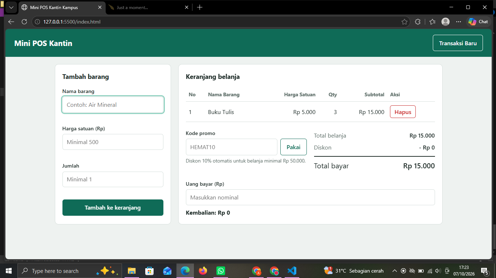
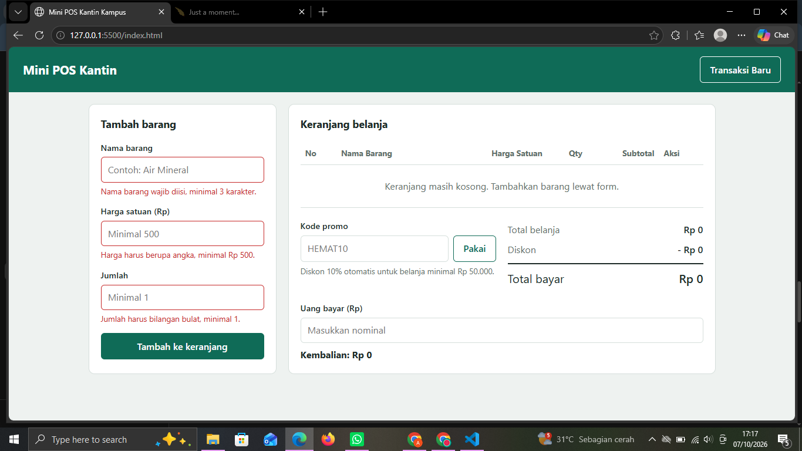
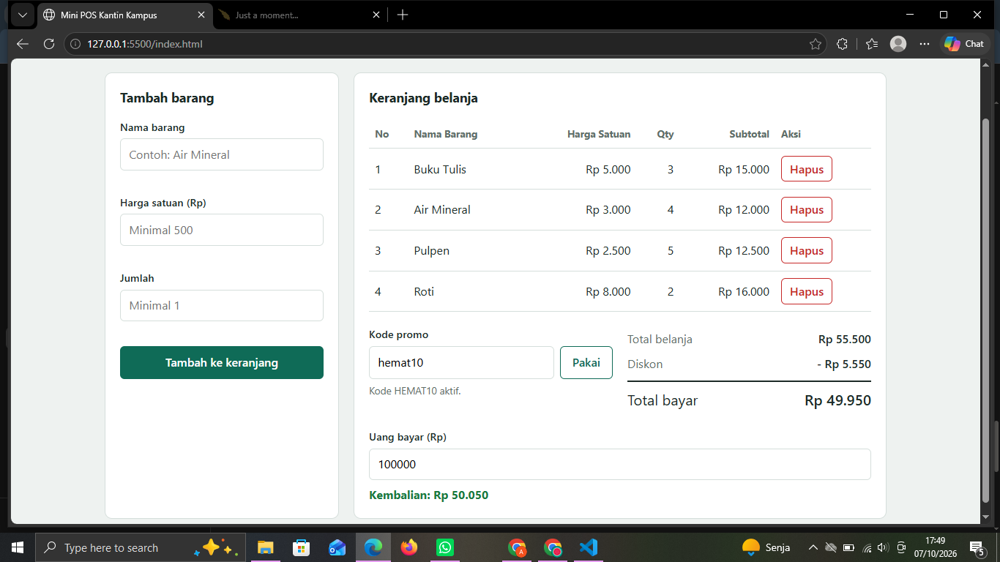
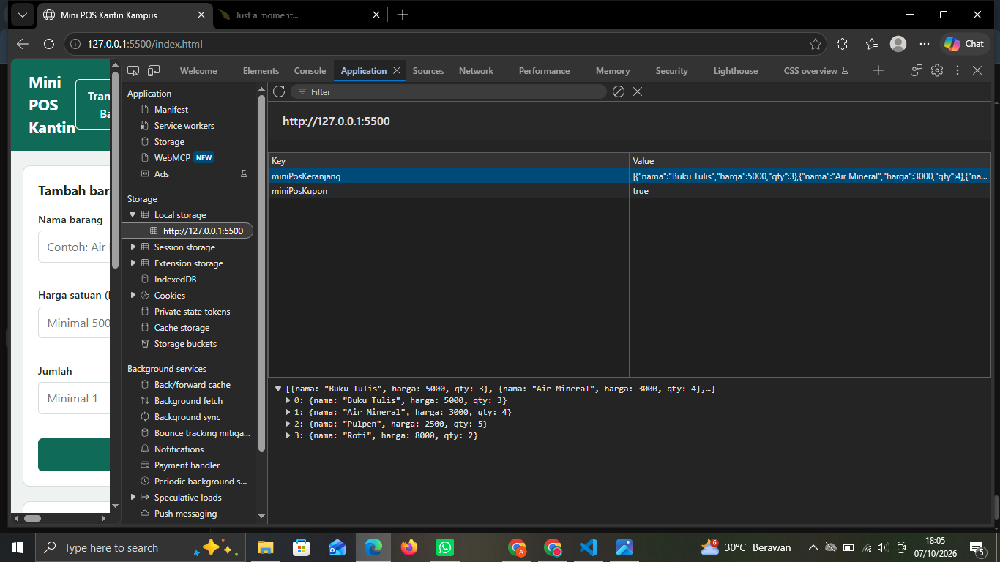

# Mini POS – Kasir & Keranjang Belanja Sederhana

## Identitas
- Nama Lengkap : Atalie Salsabila
- NIM          : 123140027
- Kelas Praktikum : RA

## Deskripsi Aplikasi
Aplikasi kasir sederhana untuk kantin/toko kampus. Kasir menambahkan barang ke keranjang, sistem menghitung subtotal, total, diskon, dan kembalian secara otomatis. Data keranjang disimpan di `localStorage` sehingga tidak hilang saat halaman di-refresh.

## Panduan Menjalankan
1. Clone repository: `git clone https://github.com/[username]/pemrograman_web_itera_[NIM].git`
2. Buka folder `ataliesalsabila_123140027_pertemuan1` di VS Code.
3. Klik kanan `index.html` → **Open with Live Server** (atau buka langsung file `index.html` di browser).

## Daftar Fitur
- [x] Validasi nama barang (wajib, min. 3 karakter)
- [x] Validasi harga (angka, min. Rp 500)
- [x] Validasi qty (bilangan bulat, min. 1)
- [x] Pesan error merah di bawah input & form reset otomatis saat sukses
- [x] Subtotal per baris (harga × qty) dan total belanja otomatis
- [x] Diskon 10% otomatis untuk belanja ≥ Rp 50.000 atau kode promo `HEMAT10`
- [x] Kalkulator uang bayar & kembalian (pesan jika uang kurang)
- [x] Tabel keranjang (No, Nama, Harga, Qty, Subtotal, Aksi) dengan tombol Hapus
- [x] Penyimpanan persisten dengan `localStorage` (`JSON.stringify` / `JSON.parse`)
- [x] Tombol Transaksi Baru untuk mengosongkan keranjang dan `localStorage`
- [x] Format Rupiah dan tampilan responsif

## Tangkapan Layar
> Ganti dengan screenshot milikmu (simpan di folder `screenshot/`).

## Tangkapan Layar

### 1. Tampilan form input utama

### 2. Tampilan validasi error

### 3. Tampilan hasil perhitungan dan tabel keranjang

### 4. Tampilan hasil perhitungan dan tabel keranjang

## Penjelasan Teknis Singkat
- **Validasi**: fungsi `validasiForm()` memeriksa tiap input, menampilkan pesan di elemen `.error` di bawah input yang salah, dan mengembalikan `false` sehingga barang tidak masuk keranjang.
- **Kalkulator**: `hitungTotal()` menjumlahkan `harga × qty` dengan `reduce()`. `hitungDiskon()` memberi 10% jika total ≥ Rp 50.000 atau kupon `HEMAT10` aktif. `hitungKembalian()` menghitung `uang bayar − total akhir` dan memberi peringatan jika kurang.
- **LocalStorage**: array `keranjang` diserialisasi dengan `JSON.stringify()` di `simpanData()` setiap ada perubahan, lalu dimuat kembali dengan `JSON.parse()` di `muatData()` saat halaman dibuka.
