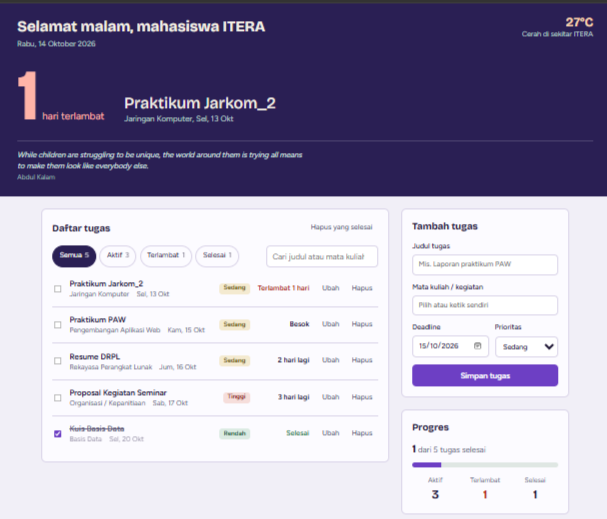
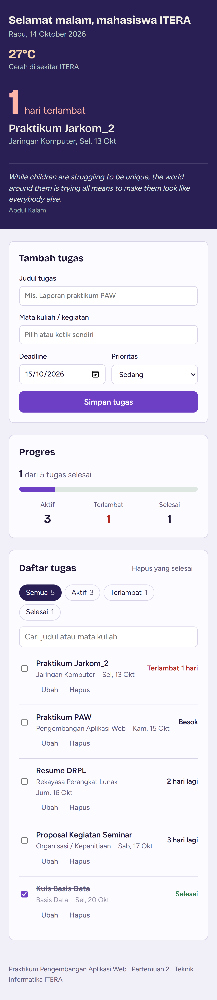

# Pos Tugas ITERA — Personal Dashboard

Dashboard pribadi untuk mahasiswa yang mengelola deadline tugas kuliah dan kegiatan organisasi.
Praktikum Pengembangan Aplikasi Web, Pertemuan 2 (JavaScript Next Gen / ES6+), Teknik Informatika ITERA.

**Nama:** _Atalie Salsabila_  **NIM:** _123140027_

## Fungsi Aplikasi

Masalah yang diselesaikan: deadline tugas sering tercecer di chat dan catatan. Aplikasi ini menempatkan
**deadline terdekat** sebagai hal pertama yang terlihat (hitung mundur besar di bagian atas), lalu
membantu mengurutkan sisanya berdasarkan seberapa dekat tenggatnya.

### Fitur

| Fitur | Keterangan |
|---|---|
| Tambah tugas | Judul, mata kuliah/kegiatan, deadline, dan prioritas (tinggi/sedang/rendah) |
| Ubah tugas | Lewat dialog edit |
| Hapus tugas | Dengan konfirmasi; tersedia juga "Hapus yang selesai" |
| Tandai selesai | Centang tugas, judul dicoret |
| Hitung mundur deadline | Deadline terdekat ditampilkan besar; status otomatis: aktif, terlambat, selesai |
| Filter dan pencarian | Filter status beserta jumlahnya, cari berdasarkan judul atau mata kuliah |
| Progres | Persentase tugas selesai dan ringkasan aktif/terlambat/selesai |
| Cuaca kampus | Cuaca real-time sekitar ITERA dari Open-Meteo |
| Kutipan harian | Kutipan motivasi acak dari DummyJSON |
| Tugas contoh | Tombol untuk mengisi daftar awal dari JSONPlaceholder |
| Penyimpanan lokal | Semua tugas disimpan di `localStorage`, tetap ada setelah browser ditutup |

## Screenshot

Tampilan desktop:



Tampilan mobile:



> Catatan: screenshot diambil dengan data tugas contoh. **Ganti dengan screenshot dari aplikasi
> yang kamu jalankan sendiri** (data cuaca dan kutipan asli) sebelum dikumpulkan.

## Cara Menjalankan

1. Buka folder project di VS Code.
2. Klik kanan `index.html`, pilih **Open with Live Server**.
3. Jangan membuka `index.html` dengan double-click (`file://`), karena `type="module"` akan diblokir CORS.

## Struktur Project

```
personal-dashboard/
├── index.html
├── css/style.css
├── screenshots/
└── js/
    ├── main.js            # entry point: render DOM + event handler
    ├── app.js             # class TaskItem dan DashboardApp
    └── modules/
        ├── data.js        # konstanta: endpoint API, prioritas, mata kuliah
        └── utils.js       # fungsi bantu: tanggal, escape HTML, dll.
```

## Daftar Fitur ES6+ yang Diimplementasikan

### 1. `let` dan `const`
`const` dipakai untuk semua nilai yang tidak di-assign ulang. `let` hanya dipakai di tempat yang memang berubah.

| Penggunaan | File : baris |
|---|---|
| `const` untuk instance app, konfigurasi, dan hasil fetch | `js/main.js:14`, `js/main.js:17`, `js/app.js:10`, `js/app.js:163` |
| `let noticeTimer` (di-assign ulang setiap notifikasi muncul) | `js/main.js:34` |

### 2. Arrow Functions (lebih dari 3)

| Fungsi | File : baris |
|---|---|
| `getJSON` (async arrow) | `js/app.js:9` |
| Callback `.map`, `.find`, `.filter` pada CRUD | `js/app.js:69`, `js/app.js:93`, `js/app.js:103`, `js/app.js:115` |
| `count` (arrow di dalam getter `stats`) | `js/app.js:150` |
| `$` (helper selector) | `js/main.js:15` |
| `dueLabel`, `notify` | `js/main.js:26`, `js/main.js:35` |
| `taskTemplate`, `emptyTemplate`, `nextUpTemplate` | `js/main.js:45`, `js/main.js:61`, `js/main.js:70` |
| `renderHeader`, `renderNext`, `renderFilters`, `renderList`, `renderStats`, `render` | `js/main.js:87`–`js/main.js:135` |
| Event handler submit/click/input | `js/main.js:188`, `js/main.js:205`, `js/main.js:234`, `js/main.js:255` |
| Helper utilitas: `pad`, `escapeHtml`, `toISO`, `daysUntil`, dll. | `js/modules/utils.js:5`–`js/modules/utils.js:57` |

### 3. Template Literals

| Penggunaan | File : baris |
|---|---|
| Template kartu tugas (HTML dinamis) | `js/main.js:45`–`js/main.js:59` |
| Template hitung mundur deadline terdekat | `js/main.js:70`–`js/main.js:82` |
| Template panel progres | `js/main.js:123`–`js/main.js:132` |
| Template tombol filter | `js/main.js:105`–`js/main.js:109` |
| String dinamis: label deadline, sapaan, pesan error | `js/main.js:28`, `js/main.js:31`, `js/main.js:88`, `js/app.js:11` |
| Pencarian gabungan judul + mata kuliah | `js/app.js:133` |
| Pembuat ID unik | `js/modules/utils.js:21` |

### 4. Asynchronous (Async/Await)

| Penggunaan | File : baris |
|---|---|
| Helper `getJSON` dengan `await fetch` dan cek status HTTP | `js/app.js:9`–`js/app.js:13` |
| `fetchWeather()`, cuaca Open-Meteo | `js/app.js:162` |
| `fetchQuote()`, kutipan DummyJSON | `js/app.js:173` |
| `importSampleTasks()`, tugas contoh JSONPlaceholder | `js/app.js:179` |
| `loadWidgets()` memakai `await Promise.allSettled` (dua request paralel) | `js/main.js:144`–`js/main.js:146` |
| `importSamples()` dengan `try/catch/finally` | `js/main.js:167`–`js/main.js:178` |

### 5. Classes

| Class | Peran | File : baris |
|---|---|---|
| `TaskItem` | Model data tugas, getter `daysLeft` dan `status`, method `withChanges()` | `js/app.js:16` |
| `DashboardApp` | State, CRUD, localStorage, dan pemanggilan API | `js/app.js:58` |

### 6. Fitur ES6+ tambahan

| Fitur | File : baris |
|---|---|
| **Destructuring** pada parameter fungsi | `js/main.js:26`, `js/main.js:45`, `js/main.js:70`, `js/app.js:131` |
| Destructuring objek/array pada variabel | `js/app.js:52`, `js/app.js:126`, `js/app.js:164`, `js/main.js:191`, `js/modules/utils.js:28` |
| **Spread operator** untuk state immutable | `js/app.js:48`, `js/app.js:86`, `js/app.js:98`, `js/app.js:194` |
| Default parameter | `js/app.js:17`–`js/app.js:25`, `js/modules/utils.js:8`, `js/modules/utils.js:34` |
| **ES Modules** (`import`/`export`) | `js/app.js:5`–`js/app.js:6`, `js/main.js:4`–`js/main.js:13`, seluruh `js/modules/*` |
| Getter pada class | `js/app.js:36`, `js/app.js:41`, `js/app.js:125`, `js/app.js:142`, `js/app.js:148` |
| Optional chaining `?.` dan nullish `??` | `js/main.js:212`, `js/app.js:168` |
| `Object.entries`, `Object.fromEntries` | `js/main.js:227`, `js/main.js:191` |
| Numeric separator `86_400_000` | `js/modules/utils.js:4` |

## Penggunaan localStorage

- Kunci: `pos-tugas-itera:v1` (`js/modules/data.js:4`).
- `DashboardApp.load()` membaca dan mengubah JSON kembali menjadi instance `TaskItem` (`js/app.js:66`–`js/app.js:74`).
- `DashboardApp.save()` dipanggil otomatis setiap kali data berubah lewat `setState(patch, true)` (`js/app.js:76`–`js/app.js:88`).
- Pembacaan dan penulisan dibungkus `try/catch` agar aplikasi tidak rusak bila data korup atau penyimpanan penuh.

## Catatan Keamanan

Teks dari pengguna di-escape (`escapeHtml`, `js/modules/utils.js:8`) sebelum disisipkan ke `innerHTML`, sehingga input seperti `<b>…</b>` atau `<script>` tampil sebagai teks biasa.

## API Publik yang Dipakai (tanpa API key)

- Open-Meteo: cuaca terkini di sekitar ITERA (`latitude=-5.36`, `longitude=105.31`)
- DummyJSON Quotes: kutipan acak
- JSONPlaceholder Todos: tugas contoh (`?_limit=5`)

Bila internet mati, tugas tetap bisa dipakai penuh; widget cuaca dan kutipan menampilkan pesan cadangan.
